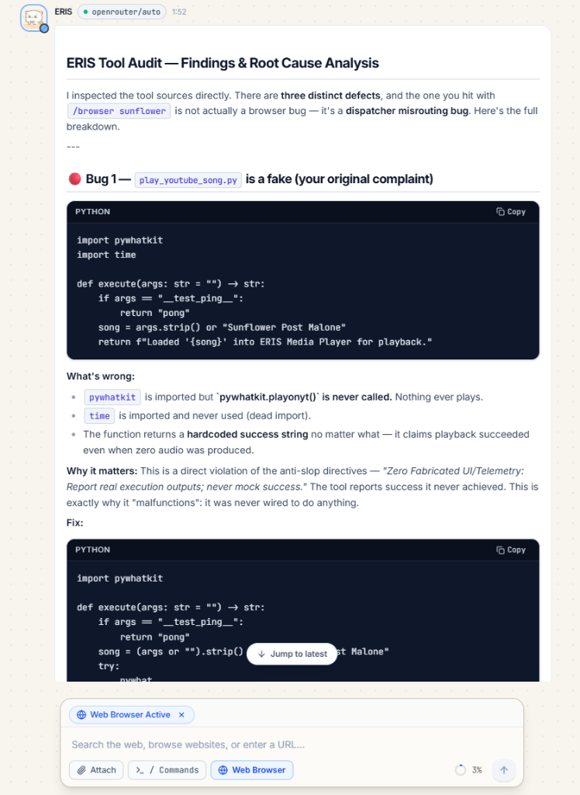
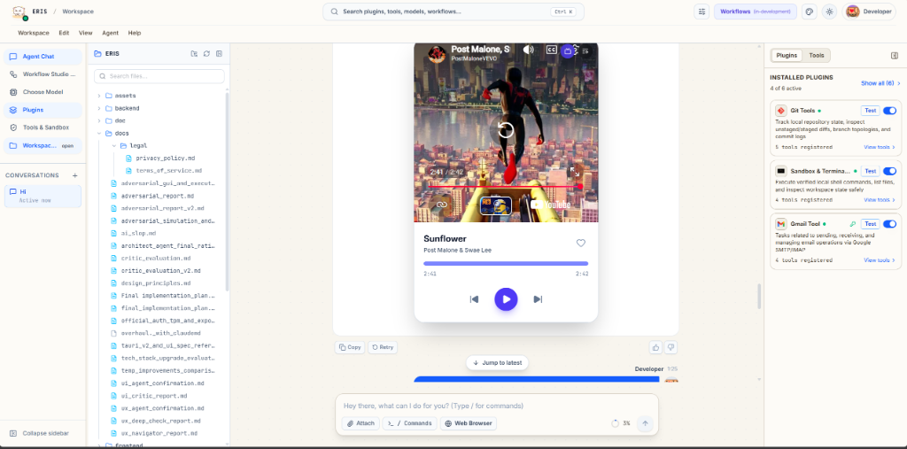
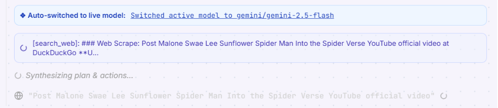
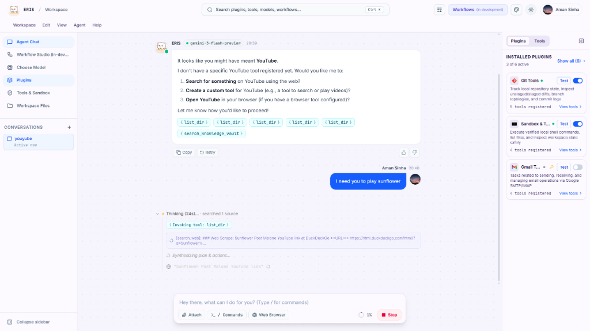
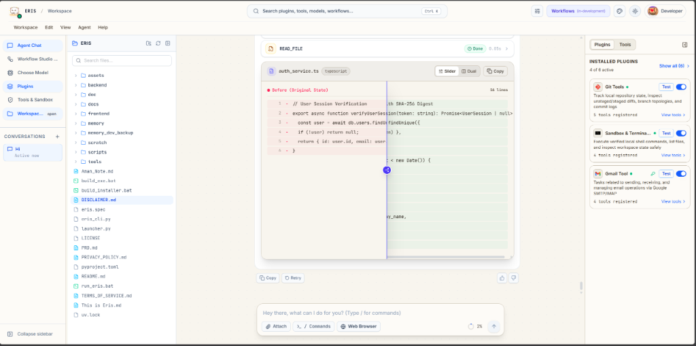

# ERIS — Autonomous Desktop AI Workspace

[](https://github.com/EzioAman/Eris/releases/tag/v0.1.1-beta)
[](LICENSE)
[](https://www.python.org/)
[-0078D6.svg?logo=windows&logoColor=white)](https://microsoft.com/windows)

**ERIS** is a local-first desktop AI workspace where agents don't just answer, they act. A LangGraph engine runs a reasoning loop, calls tools, and pauses for your approval before anything sensitive (terminal commands, script execution, file changes) runs on your machine.

<!-- TODO: add a 20-30 second demo GIF here: give ERIS a task, show the agents working, show the approval card. -->

---

## At a glance

| | |
|---|---|
| **Agent engine** | LangGraph, cyclic workflow graph with tool dispatch and observation loop |
| **Safety** | Human-in-the-loop approval gate for shell, scripts and file changes |
| **Models** | Gemini, OpenRouter, Groq, OpenAI, Anthropic, DeepSeek, or fully offline with Ollama |
| **Streaming** | Real-time reasoning and tool events over Server-Sent Events (SSE) |
| **Extensibility** | Drop a Python file into `tools/` and it is live, no restart |
| **Distribution** | Windows installer with SHA-256 verified self-updater |

---

## Table of Contents

- [Key Capabilities](#key-capabilities)
- [Multi-Agent Orchestration](#multi-agent-orchestration)
- [Retrieval and Memory](#retrieval-and-memory)
- [Observability and Testing](#observability-and-testing)
- [Visual Showcase](#visual-showcase)
- [Download and Installation](#download-and-installation)
- [Quick Start](#quick-start)
- [Tool and Plugin Architecture](#tool-and-plugin-architecture)
- [Architecture and Security](#architecture-and-security)
- [Benchmarks](#benchmarks)
- [Building from Source](#building-from-source)
- [Project Layout](#project-layout)
- [Contributing](#contributing)
- [License](#license)

---

## Key Capabilities

- **Multi-provider model routing** with live connectivity checks and failover between providers.
- **Multi-agent orchestration** with specialised sub-agents (see below).
- **Human-in-the-loop security:** risky actions pause on an interactive approval card.
- **Dynamic plugin engine:** tools in `tools/` are indexed, validated and hashed (SHA-256) automatically.
- **Interactive tool synthesis:** ERIS can write, test and register a new tool, with your approval.
- **Multi-user isolation:** conversations, memories and sessions are scoped per account.
- **Real-time reasoning stream:** thoughts, tool arguments and outputs arrive as SSE events.
- **Local encrypted vault** for API keys and preferences.
- **Self-updater:** checks, downloads and applies updates, verified against a SHA-256 manifest.

---

## Multi-Agent Orchestration

<!-- : fill this in from your code (likely backend/app/agent/subagent_personas.py and langgraph_engine.py).
     Only describe what the code really does. Delete this section if it does not exist. -->

ERIS splits work across specialised agents coordinated by a LangGraph workflow:

| Agent | Role | Tools it can use |
|---|---|---|
| Researcher | In-work (e.g. web search, gathering sources) | Not 100% reliable yet |
| Coder | In-work (e.g. writes and edits code) | Not 100% reliable yet |
| Writer | In-work (e.g. drafts and summarises results) | Not 100% reliable yet |

**How they coordinate:** Shared graph state, a supervisor/router node, and a message passing between agents.

**How safety applies:** HITL approval gate applies when a sub-agent requests a sensitive tool.

<!-- TODO: add a Mermaid or PNG diagram of the graph (supervisor -> agents -> tool runner -> approval gate). -->

---

## Retrieval and Memory

<!-- TODO: confirm each item exists in the code before keeping it. -->

- **Hybrid retrieval:** (BM25) plus vector search (pgvector) over the knowledge vault.
- **Semantic caching:** repeated or near-duplicate queries are served from cache, similarity threshold (71%).
- **Embeddings:** Gemini embeddings for images and videos ONLY.
- **Per-user memory:** stored under `memory/users/<user_id>/`.
- **Agent state checkpointing:** Handled by LanGraph (state saved in artifacts during current testing process).

Retrieval performance is documented in [Benchmarks](#benchmarks).

---

## Observability and Testing

- **Tracing with LangSmith:** every agent run, tool call and retrieval step is traced, so you can inspect the full reasoning path, latency per step and token usage. Enable it with `LANGSMITH_TRACING=true` and `LANGSMITH_API_KEY` in your `.env`.
- **Measured from traces:** the retrieval latency numbers in [Benchmarks](#benchmarks) come from LangSmith traces, not estimates.
- **Evaluation:** latency, token usage and hallucination rate are tracked across runs.
- **Tests:** run `pytest` from the repository root.

---

## Visual Showcase

### 1. Autonomous Tool Auditing and Defect Remediation
ERIS inspects its own plugin sources, finds unhandled paths and dead imports, and proposes verified fixes.



### 2. Native Dynamic Media Components
Tools can render native interactive components in the chat, such as an embedded media player.



### 3. Adaptive Model Routing and Live SSE Stream
Switch providers mid-session while watching reasoning loops and tool activity stream in.



### 4. Transparent Multi-Step Reasoning and Tool Dispatch
See reasoning duration, tool badges and intermediate thoughts as the agent works.



### 5. Interactive Code Diff Viewer
Review changes in a slider or split view before approving them.



---

## Download and Installation

Latest release: **[v0.1.1-beta](https://github.com/EzioAman/Eris/releases/tag/v0.1.1-beta)** (Windows 10 / 11, x64)

| Asset | Size | SHA-256 |
|---|---|---|
| `ERIS Setup 0.1.1-beta.exe` | 208.6 MB | `3DA0F7601177C83689A521DC632E3DF29932E70B977BECB79F115057287196DA` |

1. Download the installer from the release page.
2. Run it. It installs per user to `%LOCALAPPDATA%\Programs\ERIS` and needs no admin rights.
3. Launch ERIS, sign in, add a model API key, and start working.

> **SmartScreen:** if Windows shows "Windows protected your PC", click **More info**, then **Run anyway**. This is normal for new open-source executables.

---

## Quick Start

### 1. Connect your API keys (BYOK)
Open **Key Vault** (`Ctrl+,`) and add keys for the providers you want. Ollama needs no key. If it is running at `http://127.0.0.1:11434`, ERIS detects your local models. Keys are encrypted and stored locally.

### 2. Choose a model
Open **Choose your model**, filter by provider or capability, and pick one. ERIS verifies connectivity before you start.

### 3. Multi-user accounts
Each signed-in account gets isolated chats and memory under `memory/users/<user_id>/`.

---

## Tool and Plugin Architecture

```
tools/
├── open_browser.py
├── play_youtube_song.py
└── .tool_registry.json     # registry and integrity hashes
```

1. ERIS scans `tools/` for `.py` files.
2. Each file must define `TOOL_NAME`, `TOOL_DESCRIPTION` and `execute(args)`.
3. A SHA-256 hash is stored per file to detect changes.
4. Tools that run shell commands or make network requests get a higher risk level and go through the approval gate.

Minimal example (`tools/fetch_weather.py`):

```python
import json, urllib.parse, urllib.request

TOOL_NAME = "fetch_weather"
TOOL_DESCRIPTION = "Fetches current weather for a city. Argument: city_name (string)."

def execute(args: str = "") -> str:
    if args.strip() == "__test_ping__":   # health-check convention
        return "pong"
    city = args.strip() or "Tokyo"
    try:
        url = f"https://wttr.in/{urllib.parse.quote(city)}?format=j1"
        req = urllib.request.Request(url, headers={"User-Agent": "ERIS"})
        with urllib.request.urlopen(req, timeout=5) as r:
            cur = json.loads(r.read().decode())["current_condition"][0]
            return f"{city}: {cur['weatherDesc'][0]['value']}, {cur['temp_C']}°C"
    except Exception as e:
        return f"Error retrieving weather for '{city}': {e}"
```

Guidelines: support the `__test_ping__` probe, return readable error strings so the model can recover, and expect live reload (no restart).

**Interactive tool synthesis:** ask "Create a tool to search Hacker News". ERIS plans and writes the tool, shows the code on an approval card, and on **Approve** compiles it (`py_compile`), registers its hash, and activates it.

---

## Architecture and Security

```
┌────────────────────────────────────────────────────────┐
│               ERIS Desktop Frontend (React)            │
│       Workspace  •  Model Matrix  •  Approval Cards    │
└───────────────────────────▲────────────────────────────┘
                            │ SSE stream / REST API
┌───────────────────────────▼────────────────────────────┐
│              FastAPI + LangGraph Engine                │
│   Reasoner / Sub-agents  ->  Tool Runner  ->  Result   │
│          │                        │                    │
│          ▼                        ▼                    │
│   Human Approval Gate      Dynamic tools/ registry     │
└────────────────────────────────────────────────────────┘
```

### Human-in-the-loop approval gate
The workflow halts at an approval node before it runs shell commands, generates or edits executable scripts, or makes destructive file changes. The card shows the exact tool, its arguments, and the safety justification. Execution continues only after you click **Approve**.

### Update integrity
The self-updater reads `version.json` and verifies the SHA-256 of every download before applying it. Updating requires user confirmation.

### Thought-signature preservation
Reasoning models (for example Gemini thinking models and DeepSeek-R1) return structured reasoning blocks and signatures. ERIS keeps them intact across multi-turn tool loops to avoid validation errors.

---

## Benchmarks

*Environment: Windows 11 x64, Intel Core i7, 16 GB RAM, NVMe SSD.*

### Startup and footprint (v0.1.0-beta -> v0.1.1-beta)

| Metric | v0.1.0 | v0.1.1 |
|---|---|---|
| CLI `--version` probe | 5,020 ms (timeout) | **5.2 ms** |
| Backend cold start | 1,420 ms | **1,280 ms** |
| Full workspace ready | 3,570 ms | **3,260 ms** |
| Installer size | 246.2 MB | **208.6 MB** |
| Idle memory (RSS) | 185 MB | **176 MB** |

Full tables, including the Windows compatibility matrix, are in the [v0.1.1-beta release notes](https://github.com/EzioAman/Eris/releases/tag/v0.1.1-beta).

### Retrieval latency
*Measured from LangSmith traces.*

| Path | Latency | Notes |
|---|---|---|
| Cold (no cache) | 2,400 ms | hybrid BM25 + pgvector |
| Cache hit | 5.9 ms | semantic cache (**407x faster**) |

---

## Building from Source

**Prerequisites:** Windows 10/11 (64-bit), Python, Node.js 18+, Git.

```bash
git clone https://github.com/EzioAman/Eris.git
cd Eris

# Backend
python -m venv .venv
.venv\Scripts\activate
pip install -r backend/requirements.txt      # or: uv sync
uvicorn backend.app.main:app --host 127.0.0.1 --port 8000 --reload

# Frontend (separate terminal)
cd frontend
npm install
npm run dev
```

Backend: `http://127.0.0.1:8000` (API docs at `/docs`). Frontend: `http://localhost:5173`.

---

## Project Layout (Use your AI tools if you're recreating it yourself)

```
Eris/
├── backend/        # FastAPI app, LangGraph agents, services, database
├── frontend/       # React + Vite + Electron UI
├── tools/          # Plugin tools
├── scripts/        # Build and release scripts
├── compose.yml     # Dockerised PostgreSQL / pgvector
├── launcher.py     # Desktop launcher
├── eris.spec       # PyInstaller spec
└── version.json    # Update manifest
```

---

## Contributing

1. Fork the repo and create a branch: `git checkout -b feature/my-feature`.
2. Commit your changes.
3. Make sure `pytest` passes and `npm run build` succeeds.
4. Open a pull request.

---

## License

Licensed under the MIT. See [LICENSE](LICENSE).
